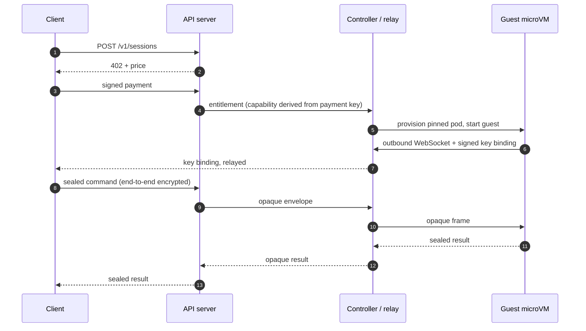

# sandbox

[](https://github.com/ejackson-vp/sandbox/actions/workflows/ci.yml)
[](https://github.com/ejackson-vp/sandbox/actions/workflows/release.yml)
[](LICENSE)
[](guest/go.mod)
[](package.json)

**Pay once with x402, get a temporary Linux machine.** No account, no API key, no
signup — and the control plane never sees the commands or files you run.

```text
Pay -> Launch sandbox -> Execute repeatedly -> Destroy
```


| Warm session ready | Exec round trip | Host cost per idle guest | Test suite |
| :---: | :---: | :---: | :---: |
| **179 ms** p50 | **53 ms** p50 | **~182 MiB** | **177 CI tests** |

Kata on two nodes with a 20-guest warm pool; p50 unless stated. The 177 are
unit, property and integration tests; the packet-level isolation suite runs
against a live cluster. [Method, percentiles and caveats](docs/performance-cluster.md).

## Why this exists

Running someone else's code used to mean a container and a prayer. Agents made it
the default case: every tool call is untrusted code. Existing sandboxes require an
account and hand the operator plaintext commands, so the operator can read
everything you run.

This takes the opposite position:

- **Pay per session, not per account.** x402 settles at the HTTP layer, so there
  is nothing to sign up for and nothing to revoke.
- **Seal payloads to the guest, not to the provider.** Commands and files are
  encrypted client-side; the API, controller and relay only route ciphertext.
- **Make the sandbox unreachable, not merely firewalled.** No ingress rules at
  all; the guest dials out.

It is a reference implementation, not a hosted service. The interesting part is
the trust boundary and the lease semantics, not the API surface.

Good fits: agent tool execution, CI and build isolation, code-runner backends,
one-off data jobs that should not touch your laptop.

## Quick start

Prerequisites: Docker, `kind`, `kubectl`, Cilium CLI, Node >= 24, Go >= 1.26.

```bash
make up             # kind + Cilium + images + deploy (~2 min)
make demo-session   # pay, create, exec, upload, run, download, destroy
make down
```

Local clusters use `runc`, not microVMs. The demo exercises the same API, relay
and guest as a real deployment.

### Verify without a cluster

Most of the system is testable in under a minute and without Kubernetes:

```bash
npm ci
make verify         # typecheck, structure lint, unit + property tests
make test           # adds integration tests against the real guest binary
```

Cluster-backed suites are explicit: `make security-test` (packet-level isolation)
and `make demo-portability` (checkpoint moves between nodes).

## How a session works



The lease starts at `READY` and is immutable. The guest watchdog, the controller
deadline and `activeDeadlineSeconds` enforce it independently, so no single bug
extends a session. On destroy or expiry the pod is deleted, relay state is
purged, and the memory-backed workspace disappears with it.

More: [architecture](docs/architecture.md) · [sessions](docs/sessions.md) ·
[warm pool](docs/warm-pool.md) · [lifecycle](docs/lifecycle.md).

## What you get

### CLI

```bash
sandbox create --tier standard                 # 5 minutes, 1 vCPU, 1 GiB
sandbox create --duration 15m --cpu 2 --memory 2Gi
sandbox exec <id> -- python3 --version
sandbox exec <id> -- bash -c "echo hello > /workspace/hello.txt"
sandbox upload   <id> ./example.py /workspace/example.py
sandbox download <id> /workspace/out.txt ./out.txt
sandbox upload   <id> ./src /workspace/src        # directory -> tar
sandbox download <id> /workspace/src ./src --extract
sandbox ls <id> /workspace --recursive
sandbox status <id>
sandbox destroy <id>
```

Tiers: `short` (60 s), `standard` (300 s), `extended` (900 s), `long` (1800 s),
plus `--duration`/`--cpu`/`--memory`/`--disk` within platform caps.
Details: [docs/cli.md](docs/cli.md).

### SDK

```ts
import { SandboxClient, FileSessionStore } from "@x402s/sdk";

const client = new SandboxClient({ apiUrl, paymentMode: "mock", store: new FileSessionStore() });
const session = await client.createSession({ tier: "standard" });
await client.waitForReady(session);
await client.exec(session, { command: ["python3", "--version"] });
await client.putFile(session, { path: "/workspace/app.py", data: Buffer.from("print(1)") });
const result = await client.exec(session, { command: ["python3", "/workspace/app.py"] });
process.stdout.write(result.stdout);
await client.destroy(session);
```

`@x402s/sdk` is a workspace package and is not published to npm yet; build it
from source (`npm ci && npm run build`). Full examples:
[examples/](examples/) · [docs/cli.md](docs/cli.md).

### API

```http
POST   /v1/sessions                        # x402-protected; body has no plaintext
GET    /v1/sessions/{id}                   # state, lease, limits
POST   /v1/sessions/{id}/operations        # { requestId, envelope }; op is inside
GET    /v1/sessions/{id}/operations?request=…  # encrypted get/list/stat
GET    /v1/sessions/{id}/requests/{rid}    # reconnect / fetch a result
DELETE /v1/sessions/{id}/requests/{rid}    # cancel a running command
DELETE /v1/sessions/{id}                   # destroy now
GET    /v1/pricing
```

All session endpoints require `X-Sandbox-Capability`. Reference:
[docs/api.md](docs/api.md).

## Trust boundary

| Property | Status |
| --- | --- |
| No accounts, no API keys | enforced |
| One settled payment → one session; replay rejected | enforced, tested |
| API accepts only ciphertext | enforced, tested |
| Control-plane logs and storage free of plaintext | enforced, tested |
| Per-session key exchange; client verifies the binding | enforced |
| No inbound network path to a sandbox | enforced, packet-tested |
| Egress only through the proxy; private destinations denied | enforced, tested |
| Separate kernel per sandbox | **only with Kata** (`deploy/kata`, `deploy/talos`) |
| Hardware-rooted attestation | **not implemented** |
| Protection from a malicious cluster operator | **no** |

The key-binding signature proves the guest holds the key you are sealing to. It
does not prove which software the guest is running, because nothing here is
measured by hardware. If the operator is your adversary, this design does not
help you — run it somewhere you trust. Full matrix:
[docs/security-guarantees.md](docs/security-guarantees.md) ·
[threat model](docs/threat-model.md).

## Performance

| Metric | n | p50 | p95 | p99 |
| --- | ---: | ---: | ---: | ---: |
| Warm server ready (pool = 20) | 30 | **179 ms** | 340 ms | 398 ms |
| Warm client ready | 30 | 665 ms | 948 ms | 956 ms |
| Cold server ready (image cached) | 10 | **2.69 s** | 3.33 s | — |
| Existing-session exec | 50 | **53 ms** | 108 ms | 216 ms |
| Destroy | 30 | 181 ms | 253 ms | 260 ms |

60 concurrent held sessions and 25/25 burst creates completed with zero failures.
The burst bottleneck is the create queue at ~1.3 creates/s, not VM boot. Cold
start assumes the image is already on the node and is not comparable to a
registry pull.

Sources: [cluster numbers](docs/performance-cluster.md) ·
[methodology](docs/benchmark-methodology.md) ·
[engineering notes](docs/engineering-notes.md). The harness and raw run data
live in [sandbox-bench](https://github.com/ejackson-vp/sandbox-bench).

## Design decisions

| Decision | Why | Trade-off |
| --- | --- | --- |
| Capability derived from the payment | Retries recover the same session with no account table | Payment intent is durable forever |
| Ciphertext-only control plane | The operator cannot read commands or files | No server-side auditing |
| Guest-initiated relay | The sandbox is unreachable by construction | No SSH; all traffic goes through one path |
| SQLite, single writer, outbox | Atomic entitlement without a distributed transaction | One controller replica |
| Kata as the isolation boundary | Separate kernel per tenant | Needs Kata-capable nodes |
| Lease enforced in three places | No single bug extends a lease | Deadline logic is duplicated |

Each has a record under [docs/adr/](docs/adr/) with the alternatives considered.

## Repository layout

```text
api/                  x402 API server + mock facilitator
sdk/                  @x402s/sdk client (payment, key binding, exec, files)
cli/                  thin CLI over the SDK
controller/           reconciler, SQLite store, relay, egress proxy
guest/                Go session supervisor + network probe
shared/               protocol, sealed-box crypto, verification, tiers
deploy/kind/          kind + Cilium setup (local dev)
deploy/kubernetes/    base manifests (runc, dev)
deploy/kata/          microVM overlay (any Kata-enabled cluster)
deploy/talos/         real-cluster overlay (Kata + published images)
examples/             runnable SDK and workload examples
scripts/              demos, asset rendering, dev secrets
tests/                unit, property, integration, security
docs/                 architecture, API, operations, ADRs, guarantees
```

Images are published on every tag:

```bash
docker pull ghcr.io/ejackson-vp/sandbox-control:0.1.15
docker pull ghcr.io/ejackson-vp/sandbox-guest:0.1.15
```

## Testing

| Suite | What it runs | Needs |
| --- | --- | --- |
| `make verify` | 129 unit + property tests | nothing |
| `npm run test:integration` | 48 tests against the real guest binary | Go toolchain |
| `make security-test` | packet-level isolation, warm pool, workload compatibility | a live cluster (`make up`) |

Unit and property tests cover the lease state machine, payment replay, capability
derivation and the sealed-box protocol. Integration tests run the real guest
binary. Security tests inspect packets on a live cluster.

## Documentation

Full index: [docs/README.md](docs/README.md).

- **New here** — [quickstart](docs/quickstart.md) · [architecture](docs/architecture.md) · [performance](docs/performance-cluster.md)
- **Security reviewer** — [guarantees](docs/security-guarantees.md) · [threat model](docs/threat-model.md) · [networking](docs/networking.md) · [transfer security](docs/transfer-security.md)
- **Operator** — [Talos deploy](deploy/talos/README.md) · [capacity model](docs/capacity-model.md) · [control-plane faults](docs/control-plane-faults.md) · [production readiness](docs/production-readiness.md)
- **Contributor** — [architecture principles](docs/architecture-principles.md) · [ADRs](docs/adr/) · [CONTRIBUTING.md](CONTRIBUTING.md)

## Status and roadmap

**Alpha.** A reference deployment, not a hosted service: payments are mock or
testnet, and there is no hardware attestation. See
[docs/production-readiness.md](docs/production-readiness.md) for the ordered
list of what is missing, and [ROADMAP.md](ROADMAP.md) for what comes next.

Non-goals: no coding agent, no GitHub integration, no persistent dev
environments, no memory snapshots (filesystem checkpoints only), no GPUs, no
accounts, no managed wallets, no mainnet payments, no enterprise features.

## Contributing

Read [CONTRIBUTING.md](CONTRIBUTING.md). Security invariants need a test, and
modules stay under 650 lines.

## Licence

MIT — see [LICENSE](LICENSE).
