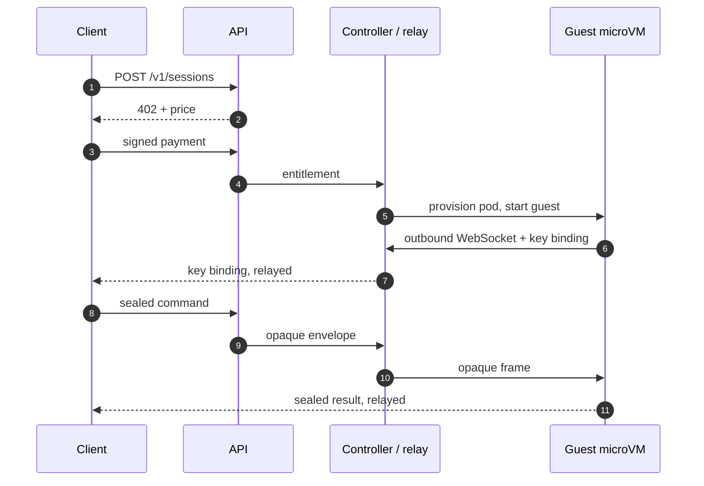

<p align="center">
  
</p>

<p align="center">
  <!-- Quality and security: does it work, and is it checked? -->
  <a href="https://github.com/ejackson-vp/sandbox/actions/workflows/ci.yml"></a>
  <a href="https://github.com/ejackson-vp/sandbox/actions/workflows/codeql.yml"></a>
  <a href="https://github.com/ejackson-vp/sandbox/actions/workflows/docs.yml"></a>
  <a href="https://scorecard.dev/viewer/?uri=github.com/ejackson-vp/sandbox"></a>
  <a href="https://github.com/ejackson-vp/sandbox/actions/workflows/release.yml"></a>
</p>

<p align="center">
  <!-- Release and toolchain -->
  <a href="https://github.com/ejackson-vp/sandbox/releases"></a>
  <a href="LICENSE"></a>
  
  <a href="guest/go.mod"></a>
  <a href="package.json">= 24"></a>
</p>

<p align="center">
  <!-- What it is -->
  
  
  
  
</p>

**Pay once with x402, get a temporary Linux machine.** No account, no API key, no
signup — and the control plane never sees what you run.


| Warm session ready | Exec round trip | Host cost per idle guest | Test suite |
| :---: | :---: | :---: | :---: |
| **127 ms** p50 | **53 ms** p50 | **~182 MiB** | **411 CI tests** |

Kata on two nodes with a 20-guest warm pool, control **0.1.16** (measured
2026-11-09); test count from CI on `main` (2026-11-10); p50 unless stated.
[Method and caveats](docs/performance-cluster.md).

## Why

Agent tool calls are untrusted code, and most sandboxes require an account and
hand the operator your plaintext commands. This does the opposite: the payment
is the identity, and commands and files are sealed client-side to the guest, so
the API, controller and relay only route ciphertext.

Good fits: agent tool execution, CI and build isolation, code-runner backends,
one-off data jobs that should not touch your laptop.

## Quick start

Prerequisites: Docker, `kind`, `kubectl`, Cilium CLI, Node >= 24, Go >= 1.26.

```bash
make up             # kind + Cilium + images + deploy (~2 min)
make demo-session   # pay, create, exec, upload, run, download, destroy
make down
```

Local clusters use `runc`, not microVMs. The demo exercises the same API, relay
and guest as a real deployment.

<details>
<summary>What the demo looks like</summary>


</details>

Without a cluster, most of the system is testable in under a minute:

```bash
npm ci
make verify         # typecheck, structure lint, unit + property tests
make test           # adds integration tests against the real guest binary
```

`make security-test` runs the packet-level isolation suite against a live cluster.

## How it works



The lease starts at `READY` and is immutable: the guest watchdog, the controller
deadline and `activeDeadlineSeconds` enforce it independently. On destroy or
expiry the pod is deleted and the memory-backed workspace disappears with it.

More: [architecture](docs/architecture.md) · [sessions](docs/sessions.md) ·
[warm pool](docs/warm-pool.md).

## Interfaces

```bash
sandbox create --tier standard                 # 5 minutes, 1 vCPU, 1 GiB
sandbox exec <id> -- python3 --version
sandbox run -- python3 --version               # one-shot: create, run, destroy
sandbox run --file data.csv=data.csv --return out.csv -- python3 analyze.py
sandbox upload <id> ./src /workspace/src       # directory -> tar
sandbox download <id> /workspace/out.txt ./out.txt
sandbox destroy <id>
```

Tiers: `short` (60 s), `standard` (300 s), `extended` (900 s), `long` (1800 s),
plus `--duration`, `--cpu`, `--memory`, `--disk` within platform caps.

```ts
import { SandboxClient, FileSessionStore } from "@x402s/sdk";

const client = new SandboxClient({ apiUrl, paymentMode: "mock", store: new FileSessionStore() });
const session = await client.createSession({ tier: "standard" });
await client.waitForReady(session);
const result = await client.exec(session, { command: ["python3", "--version"] });
await client.destroy(session);

// One-shot: fresh session, upload, exec, collect, destroy (files are
// workspace-relative). Only the "base" runtime is available today.
const run = await client.run({
  command: ["bash", "-c", "python3 main.py > out.txt"],
  files: { "main.py": "print('hello')" },
  returnFiles: ["out.txt"],
});
console.log(run.exitCode, run.stdout, run.files["out.txt"]);
```

`@x402s/sdk` builds from source (`npm ci && npm run build`), not npm.

```http
POST   /v1/sessions                            # x402-protected; body has no plaintext
POST   /v1/sessions/{id}/operations            # { requestId, envelope }; op is inside
GET    /v1/sessions/{id}/operations?request=…  # encrypted get/list/stat
DELETE /v1/sessions/{id}                       # destroy now
```

All session endpoints require `X-Sandbox-Capability`. Reference:
[docs/api.md](docs/api.md) · [docs/cli.md](docs/cli.md).

## Performance

| Metric | n | p50 | p95 |
| --- | ---: | ---: | ---: |
| Warm server ready (pool = 20) | 50 | **127 ms** | 286 ms |
| Warm client ready | 50 | **395 ms** | 708 ms |
| Existing-session exec | 50 | **53 ms** | 108 ms |
| Cold server ready (image cached) | 10 | 2.69 s | 3.33 s |

0.1.16 caches the x402 challenge for repeat creates and removes a redundant
capacity round trip; warm client ready fell from 665 ms to 395 ms (p50, steady
client with the challenge cached) and the server side from 179 ms to 127 ms.

These numbers were taken on **0.1.16**. They have not been re-measured on 0.1.20,
which removes another create-path round trip (the create response now carries
the session view, and the API no longer re-reads the session after payment), so
treat them as a conservative floor until the cluster benchmark is re-run.

60 concurrent held sessions and 25/25 burst creates completed with zero failures;
the bottleneck is the create queue at ~1.3/s, not VM boot. Sources:
[cluster numbers](docs/performance-cluster.md) ·
[engineering notes](docs/engineering-notes.md) ·
[harness](https://github.com/ejackson-vp/sandbox-bench).

## Documentation

- **New here** — [quickstart](docs/quickstart.md) · [architecture](docs/architecture.md)
- **Security reviewer** — [guarantees](docs/security-guarantees.md) · [threat model](docs/threat-model.md) · [networking](docs/networking.md)
- **Operator** — [Talos deploy](deploy/talos/README.md) · [capacity model](docs/capacity-model.md) · [production readiness](docs/production-readiness.md)
- **Contributor** — [ADRs](docs/adr/) · [CONTRIBUTING.md](CONTRIBUTING.md)

Full index: [docs/README.md](docs/README.md).

## Status

**Alpha.** A reference deployment, not a hosted service: payments are mock or
testnet, and there is no hardware attestation. What is missing, in order:
[docs/production-readiness.md](docs/production-readiness.md). What comes next:
[ROADMAP.md](ROADMAP.md).

Current limitations: no memory snapshots (filesystem checkpoints only), no GPUs,
no arbitrary OCI images, mock or testnet payments only, and checkpoints are
plaintext on disk (see
[docs/adr/0007](docs/adr/0007-checkpoint-at-rest-plaintext.md)).

Non-goals: a hosted commercial service, accounts, managed wallets, mainnet
payments, hardware-attestation claims, feature parity with general-purpose
sandbox platforms, and application-specific integrations. It does not ship a
coding agent; callers may run one. Prepared runtimes and stateful sessions are
in scope; a full IDE or dev-platform is not.
